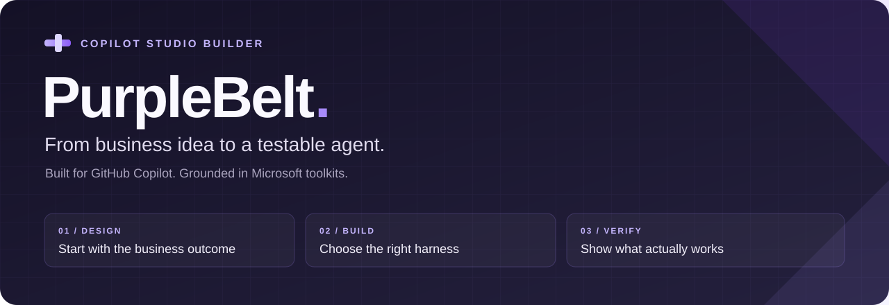

<p align="center">
  
</p>

<p align="center">
  <strong>ให้ GitHub Copilot ช่วยสร้าง Copilot Studio Agent อย่างเป็นระบบ</strong><br />
  เริ่มจากโจทย์ธุรกิจ เลือก harness ให้ถูก แล้วทำหนึ่งงานให้จบพร้อมหลักฐานทดสอบ
</p>

<p align="center">
  <a href="LICENSE"></a>
  
  
  <a href="docs/VALIDATION.md"></a>
</p>

<p align="center">
  <a href="#เริ่มใช้">เริ่มใช้</a> ·
  <a href="docs/PLAYBOOK.md">ตัวอย่างคำสั่ง</a> ·
  <a href="#เลือกเส้นทางให้ตรงกับ-agent">เลือก harness</a> ·
  <a href="docs/VALIDATION.md">ทดสอบอะไรแล้ว</a>
</p>

## Build less plumbing. Deliver more useful work.

**PurpleBelt** เป็นชุด Agent Skills สำหรับ **GitHub Copilot ใน VS Code** ที่เสริมเครื่องมือ Microsoft ด้วย Business/Product thinking, บทเรียนจาก hackathon และวิธีตรวจว่างานสำเร็จจริง

คุณบอกผลลัพธ์ที่ต้องการ → Copilot ตรวจโปรเจกต์และข้อจำกัด → เลือกเครื่องมือให้ตรง harness → สร้างงานชิ้นเล็กที่ทดสอบได้

| อยากทำอะไร | PurpleBelt ช่วยอย่างไร |
|---|---|
| เปลี่ยนไอเดียเป็น Agent | แปลงโจทย์เป็น user journey, ข้อมูล, tools และเกณฑ์รับงาน |
| Vibe code แล้วตามแก้ไม่จบ | อ่านไฟล์จริง ใช้ schema ให้ถูก และแก้เป็น diff ที่ตรวจได้ |
| ออกแบบระบบ hybrid ให้คุ้ม | แบ่งงานเป็น rules, prompts และ reasoning แล้วเทียบต้นทุน เวลา และเส้นทางส่งต่องาน |
| ทำงานให้ทัน hackathon | เริ่มจาก demo story และหนึ่ง journey ก่อนเพิ่มฟีเจอร์ |
| ใช้ในองค์กรที่มีข้อจำกัด | แยก connector class, DLP, สิทธิ์ และ capacity ก่อนเลือกทางทำ |
| Agent บอกสำเร็จทั้งที่งานไม่เกิด | ตรวจผลของแต่ละ action และสถานะจริง แยกจากข้อความที่โมเดลตอบ |

## เริ่มใช้

สิ่งที่ต้องมี: GitHub Copilot ที่รองรับ Agent Skills และ Python 3.10+ สำหรับ utilities ของ PurpleBelt ส่วนการเชื่อม Copilot Studio ต้องมีเครื่องมือและสิทธิ์ตาม harness ด้านล่าง

```powershell
git clone https://github.com/beukkung/PurpleBelt-Copilot-Agent.git
cd PurpleBelt-Copilot-Agent
py -m pip install -r requirements.txt
py scripts/verify_bundle.py
py scripts/install.py --target "C:\Projects\MyAgent" --harness standard
```

เปลี่ยน `C:\Projects\MyAgent` เป็น **โฟลเดอร์โปรเจกต์ Agent จริง** แล้วเปิดโฟลเดอร์นั้นใน VS Code ตรวจว่า Copilot พบ skills ก่อนเริ่มใช้ บน macOS/Linux ใช้ `python3` และ path ของคุณ

พิมพ์ใน GitHub Copilot Chat:

```text
ใช้ copilot-studio-builder ตรวจ workspace นี้และระบุ harness จากไฟล์จริง
เป้าหมาย: สร้างตัวช่วยรับคำขอบริการภายใน
ทำหนึ่งเส้นทางให้จบ พร้อมกรณีข้อมูลไม่ครบและ tool ล้มเหลว
แสดง diff และรายงานแยก local checks, tenant tests และสิ่งที่ยังต้องตั้งค่า
```

ยังไม่มี workspace? เปิดโฟลเดอร์ PurpleBelt นี้และระบุว่าอยากสร้าง Agent ใหม่ พร้อม scenario และ environment ที่ได้รับอนุญาต ให้ Copilot ตรวจ prerequisites ก่อนสร้าง cloud resources

> มี skills เวอร์ชันเก่าอยู่แล้ว? Installer จะหยุดก่อนเขียนทับ ใช้ขั้นตอน [อัปเดตอย่างปลอดภัย](docs/PLAYBOOK.md#อัปเดตชุดเดิม) เพื่อเก็บ customizations ของคุณ

## เลือกเส้นทางให้ตรงกับ Agent

| | Standard | Microsoft Copilot harness |
|---|---|---|
| เหมาะกับ | Conversations, topics และกระบวนการที่กำหนดเส้นทางชัดเจน | งานที่ใช้ procedures, tools, files และ iterative orchestration |
| ฐาน Microsoft | [skills-for-copilot-studio](https://github.com/microsoft/skills-for-copilot-studio) | [copilot-studio-plugin](https://github.com/microsoft/copilot-studio-plugin) |
| เครื่องมือหลัก | Studio extension สำหรับ clone/push/pull; Node.js 18+ ตาม toolkit | PAC CLI 2.9.3+ ตาม plugin; ตรวจ help และ prerequisites ของแต่ละ operation |
| ติดตั้ง discovery | `--harness standard` | `--harness agentic` |
| เรียกโดยตรง | `copilot-studio-standard`, `mcs-*` | `copilot-studio-agentic`, `mcsa-*` |

ใช้ `--harness all` เมื่อต้องการทั้งคู่ ตัวติดตั้งเก็บ source bundles ทั้งสองไว้เหมือนกัน แต่จำกัด discovery ตามตัวเลือกของคุณ Copilot ควรอ่านเฉพาะ harness และ operation ที่เกี่ยวข้อง

**GitHub Copilot ใน VS Code คือผู้ช่วยพัฒนา** ส่วน harness คือ runtime ของ Agent ใน Copilot Studio การมี Copilot หรือ extension ไม่ได้บอกว่า Agent ใช้ harness ไหน

Microsoft ประกาศเปลี่ยนชื่อ GitHub Copilot harness เป็น **Microsoft Copilot harness** เมื่อ 28 ต.ค. 2026; repo ต้นฉบับยังมีชื่อ GHCP/MCS2 อยู่ [อ่านประกาศ](https://www.microsoft.com/en-us/copilot/blog/copilot-studio/the-github-copilot-harness-in-copilot-studio-is-now-the-microsoft-copilot-harness/)

## Let the simple steps stay simple.

PurpleBelt ช่วยคิดทั้งระบบได้: ใช้กฎกรองและลดข้อมูลก่อน เรียก AI ตามความจำเป็น แล้วเลือกวิธีส่งต่องานที่รองรับจริง ทั้ง native workflow, events หรือข้อมูลร่วมกัน ไม่ล็อกว่าต้องใช้ SharePoint หรือสอง harness ทุกครั้ง

ให้ Copilot เสนอได้ไม่เกิน 3 ทางเลือก พร้อมคำแนะนำ เงื่อนไขต้นทุน และแผนทดลองวัดผล [อ่านวิธีวางแผน](references/hybrid-architecture.md) · [ดู prompt พร้อมใช้](docs/PLAYBOOK.md#6-ออกแบบ-hybrid-ให้เหมาะกับงาน)

## One outcome. A few good moves.

- **สร้าง:** อ่าน workspace → กำหนดผลลัพธ์ → สร้าง journey แรก → ตรวจ → sync → ทดสอบจริง
- **แก้:** ทำให้เห็นปัญหาซ้ำ → ดู input/output จริง → แก้จุดที่เป็นสาเหตุ → ทดสอบกรณีเดิม
- **แข่ง:** เล่า pain ให้ชัด → ทำผลลัพธ์ที่ demo ได้ → แสดงหลักฐาน → ซ้อมและเก็บ fallback

ตัวอย่างพร้อมใช้: [สร้าง Agent / แก้ flow / เตรียม hackathon / ย้าย harness](docs/PLAYBOOK.md)

## Trust the evidence

| มีให้แล้ว | ต้องตรวจใน environment ของคุณ |
|---|---|
| Toolkit Microsoft สองชุดแบบ pinned และเก็บ LICENSE เดิม | Authentication, permission, license/capacity และ DLP |
| Installer เลือก harness และไม่เขียนทับ skill เดิม | Native CLI/extension dependencies และ service availability |
| Static preflight ตรวจ syntax และ harness markers บางส่วน | Schema/Power Fx semantics, tool bindings และผลของ action จริง |
| Local regression tests และ SHA-256/Git blob integrity checks | Cloud creation, migration, sync, publish และ published-channel UX |

**สถานะ: development toolkit ที่มี local checks; ยังไม่ผ่านการรับรองการทำงานกับ tenant จริงจากโปรเจกต์นี้** ไม่มีคำอ้างว่าเร็วขึ้นกี่เท่าหรือรับประกันชนะ hackathon [ดูหลักฐานและข้อจำกัด](docs/VALIDATION.md)

<details>
<summary><strong>What's inside — เปิดดูรายละเอียด</strong></summary>

- **39 original Microsoft skills:** 31 Standard + 8 modern, ไม่แก้ไฟล์ต้นฉบับ
- **42 discovery entries** เมื่อใช้ `all`: Builder + 2 harness adapters + 39 operation wrappers
- **8 original specialist guides** รวมทั้งสอง repo; installer ไม่ได้ลงทะเบียนเป็น custom-agent personas
- **198 original upstream files** พร้อม commit และ hash ทุกไฟล์ใน lock manifests
- Schema references, templates, patterns, helper scripts และชุดทดสอบต้นฉบับ
- บทเรียนที่สังเคราะห์จาก public hackathon repos พร้อมระบุว่าอ่านหลักฐานประเภทใด
- แยก `mcs-*` กับ `mcsa-*` เพื่อไม่ให้ชื่อ operation ชนกัน
- Hooks, plugin commands และ telemetry ต้นฉบับไม่ถูกเปิดใช้อัตโนมัติ

[Skill หลัก](SKILL.md) · [Toolkit catalog](references/upstream-catalog.md) · [Hackathon patterns](references/hackathon.md) · [Sources](references/sources.md)

</details>

<details>
<summary><strong>ตรวจชุดเครื่องมือด้วยตัวเอง</strong></summary>

```bash
python -m unittest discover -s tests -v
python scripts/verify_bundle.py
python scripts/preflight.py "/path/to/actual-agent-workspace"
```

Preflight เป็น read-only heuristics ไม่ใช่ native schema/Power Fx/DLP validation และไม่อ่าน `.mcs/conn.json` ยังไม่มี tested Solution ZIP builder หรือ full validator สำหรับ unpacked solution components

ต้นฉบับ Standard เป็น experimental research project ส่วน modern plugin เป็น work in progress การอยู่ใน Microsoft GitHub ไม่ได้หมายถึง supported product หรือสิทธิ์ใช้งาน cloud [Attribution](NOTICE.md)

</details>

---

Built by **[beukkung](https://github.com/beukkung)** · Independent integration · [MIT](LICENSE)

**A useful agent is measured by the work it completes.**
