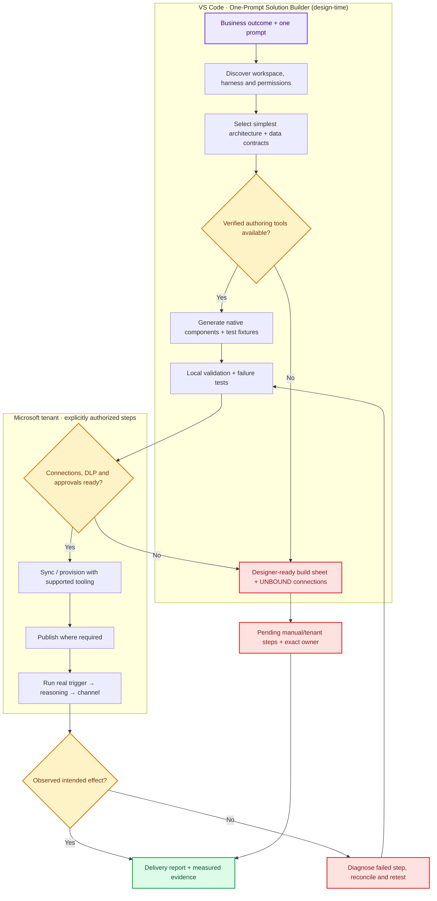
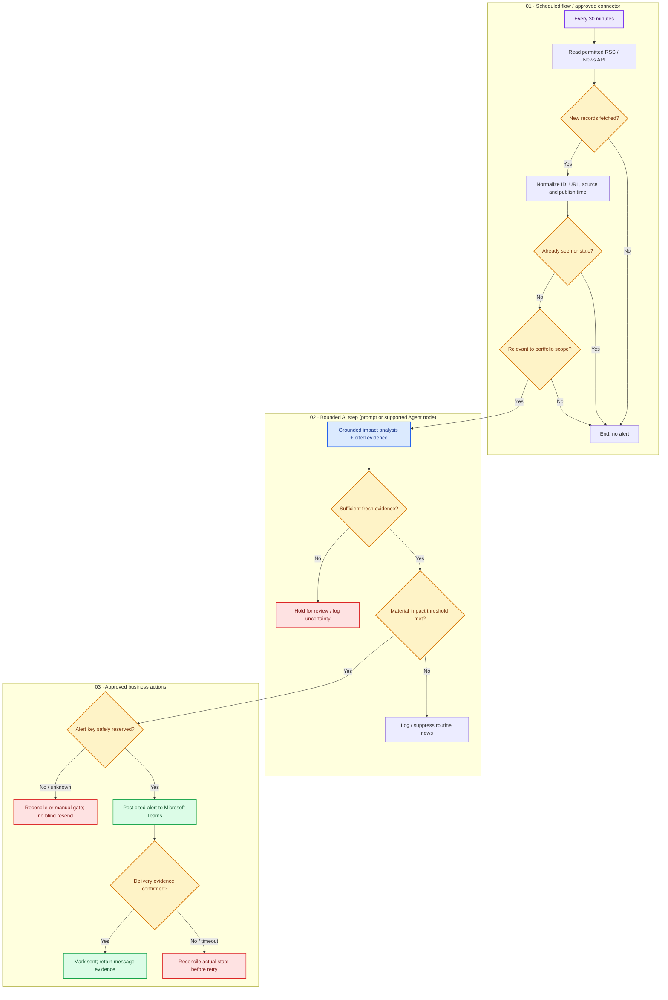

# Workflow diagrams

Diagrams for [PurpleBelt's One-Prompt Solution Builder](../../references/one-prompt-solution-builder.md).

**Architecture blueprints only.** These pictures are documentation rendered directly by GitHub from editable [Mermaid](https://docs.github.com/en/get-started/writing-on-github/working-with-advanced-formatting/creating-diagrams) text. They do **not** provision a Copilot Studio Workflow or prove connected tenant operation.

## 1. One-prompt builder — design, build and release gates

This is the **developer experience** inside VS Code. It may generate some components directly, but a workflow canvas, connection, publication or Teams test can require supported tenant tooling and authorization. A diagram is never the deployment artifact.

## 2. Financial News Intelligence — runtime workflow

Reference scenario: an approved feed is polled on a schedule, deterministic filters run first, then a bounded AI step explains relevant news, and only verified high-importance alerts reach Teams. Use **either a bounded AI Prompt or a compatible Agent node** when the chosen workflow/runtime supports it; do not assume Power Automate can invoke modern-harness agents.

**Implementation notes:** Source connectors, identities, quotas, portfolio permissions and Teams destination are **UNBOUND** until verified in the user's environment. An alert ledger can be a permitted SharePoint list or another suitable durable store; an atomic unique-claim mechanism must actually be supported to avoid concurrent duplicates. If that mechanism is unavailable, use a controlled consumer/reconciliation process and explicitly report residual duplicate risk.

The diagram's `SENT` state requires a checked, observable Teams delivery effect, not just an AI answer or local simulation. No snapshot may be labeled live news without an operational trigger. A failed Teams send should not blindly replay if a prior attempt may already have posted.

## How to maintain these diagrams

1. Edit the fenced `mermaid` code in this Markdown file. GitHub re-renders it automatically. Keep the diagram text editable and source-controlled (no PNG-only design).
2. For a new business project, generate its own `docs/diagrams/workflow.md` using [Diagram design guide](../../references/diagram-design.md). Include a **builder/architecture** view and a **runtime/decision** view for multi-component work.
3. Label proposal versus actual implementation explicitly; tie each external edge to a connector/identity, and each side effect to an observed test.
4. After changing connections or branch conditions, update the architecture diagram, build sheet and acceptance tests in the same change.
