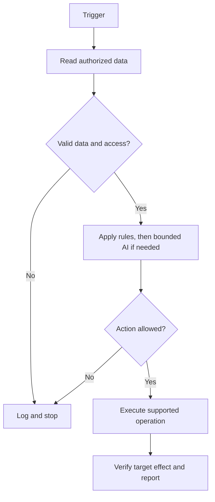

# Diagram-first workflow design

Use this guide alongside `one-prompt-solution-builder.md` and `workflows.md` whenever a user requests architecture, flow design or a multi-component Copilot Studio solution. Deliver **readable, editable diagrams in the business project's repository**, not merely an unreviewed AI sketch.

## Deliverables

- For a multi-component **build**: create `docs/diagrams/workflow.md` in the **business project** with two GitHub-native Mermaid diagrams: (1) the build/provisioning boundary, and (2) runtime trigger -> decisions -> AI -> side effects. Include a short explanation of each diagram and a link from the project README when useful.
- For a simpler single-component flow: one runtime Mermaid flowchart is enough. Avoid diagram count for its own sake.
- Capture source, trigger/cadence, data provenance, identity, tools, integrations, approvals, retries, failure branch, no-data branch, and evidence of completed effects. Clearly distinguish human approval from algorithmic branching.
- Use **flowchart TD** for complex branching or **flowchart LR** for a short overview. Use subgraphs to separate `VS Code/design-time`, `tenant/deployment`, and `runtime` boundaries; for runtime flows, group deterministic, reasoning and write stages. For important asynchronous producers/consumers, add a sequence diagram only if it clarifies ownership/acks.
- Use simple Mermaid node identifiers, quoted label text, stable classes and limited syntax. Keep diagram labels short. GitHub can render Mermaid fenced blocks, so no external renderer, generated raster file or diagram plugin is required for the basic workflow.
- Never embed real API keys, account names, customer/portfolio personal data, tenant IDs or unapproved source endpoints.

## Diagram accuracy contract

Every node must map to a **real capability, proposed component or explicit manual gate**, and be labeled accordingly. A Mermaid box is not a provisioned agent, live workflow, connection, notification, deployment or evidence. Do not draw a Standard -> modern runtime invocation without a verified supported bridge.

Represent what **happens when**:
1. **No input** or expired/stale data: stop or report, do not invent an alert.
2. **Duplicate input**: dedup based on a stable key, with atomic enforcement only when actually supported.
3. **Reasoning failure**: hold, safely fallback or ask for review, not an unconditional "send".
4. **Write timeout**: reconcile target state before retrying; separate accepted, stored, posted and observed statuses.
5. **Cloud gate not ready**: show `UNBOUND`/pending operator steps rather than an imaginary connection.

Add diagrams after choosing an architecture, before generating dependent components. Compare the diagram to the **actual** generated changes, designer canvas and tenant run evidence before marking deployed. If the architecture changes, update the diagram; do not silently treat a reference picture as production truth.

## Example

Use [these two GitHub-rendered diagrams](../docs/diagrams/README.md) as the reference visual style for a One-Prompt Solution Builder and a scheduled financial-news workflow.

A minimal single-flow Mermaid scaffold for a different project:

The scaffold is documentation, not a directly importable Copilot Studio flow.
